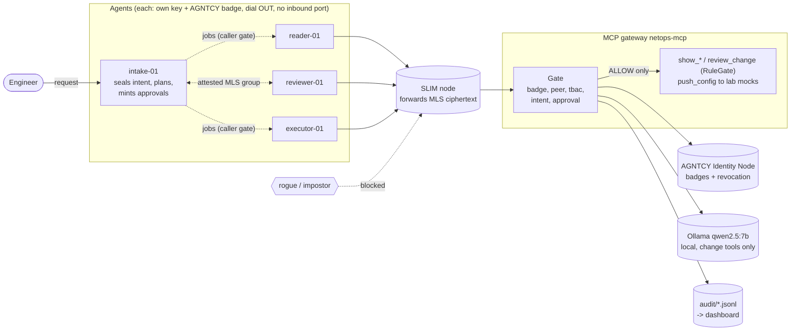
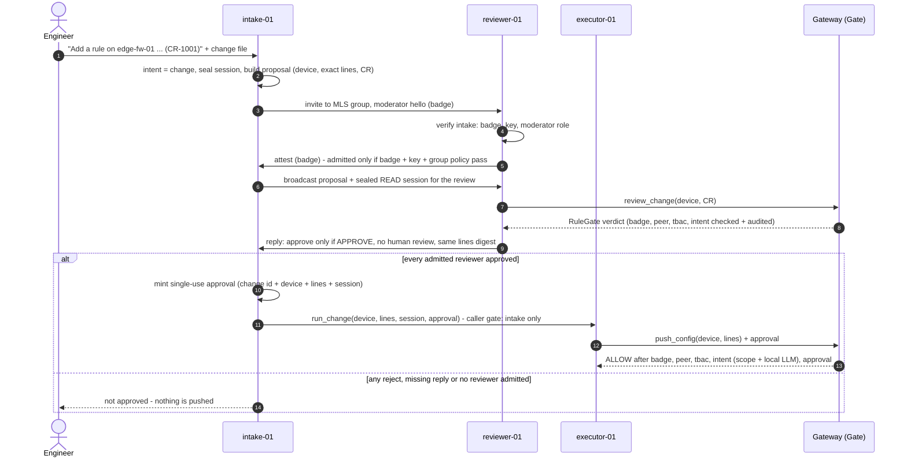

# AgentTrustSec

**Zero-trust for AI agents, modeled on Cisco TrustSec, built on the AGNTCY stack.**

A multi-agent network-operations system where every agent proves *who it is* (Agent
Badge), proves it *holds the key* behind that identity, talks over an *encrypted fabric*
(SLIM + MLS), and may only call tools that match *its role* (TBAC) **and** *the user's
actual intent*. Anything not explicitly allowed is blocked, and every decision is logged.

> Lab project. Network tools are mocks or lab devices — never production.

---

## Why

AI agents are getting real tool access: they read device configs, review firewall
changes, and push configuration. That turns classic agent failures into network incidents:

* a **prompt-injected or compromised agent** tries a change during a read-only task
* a **stolen credential** is replayed by an impostor agent or a fake tool server
* an **over-privileged agent** calls tools far outside its job
* a **revoked agent** keeps working because nobody re-checks its identity
* an **eavesdropper** reads agent-to-agent traffic or slips into a review group

Network security solved the equivalent problems for users and devices a long time ago.
Cisco TrustSec / ISE does it with 802.1X identity, security-group tags, an SGACL matrix,
posture, MACsec, enforcement at the switch, and Live Logs. **AgentTrustSec applies the
same model to agents**, using the open AGNTCY stack from Cisco Outshift.

## Vision

An engineer asks for a read-only ACL audit. Behind the scenes an intake agent seals that
intent, reader and reviewer agents gather and assess data, and an executor exists for
approved changes only. If any agent goes rogue — or an attacker copies a badge, spoofs a
name, or stands up a fake tool server — the call is **blocked before the tool runs**, and
the audit trail shows exactly which layer stopped it and why.

Design principles (non-negotiable, see `CLAUDE.md`):

1. **Deny by default.** No wildcard allows, no dev bypass; an error in any check = BLOCK.
2. **Never weaken a check to pass a test.**
3. **Every decision is audited** — one record per call, every check result included.
4. **Change tools are special** — valid badge, allowed role, `change` intent, semantic pass.
5. **No secrets in the repo; lab only; verify fast-moving AGNTCY APIs before use.**

## The mental model: TrustSec ↔ AGNTCY

| TrustSec / ISE | AgentTrustSec |
|---|---|
| 802.1X identity + machine cert | **Agent Badge** — W3C Verifiable Credential, JOSE-signed (AGNTCY Identity) |
| EAP-TLS proof of private key | **`peer` check** — the agent's SLIM token must be signed by the key its badge binds |
| ISE as policy server | Identity Node + `authz/` policy engine |
| SGT (security group tag) | Agent role: `intake`, `reader`, `reviewer`, `executor` |
| SGACL matrix | `policies/tbac.yaml` (role → allowed tools) |
| Posture / context | User intent (`read` vs `change`) sealed into the session at intake |
| CRL / OCSP check | Badge must be **published and not revoked** on the Identity Node |
| MACsec / encrypted fabric | **SLIM** sessions with **MLS** end-to-end encryption |
| Enforcement point (switch) | `authz/gate.py`, run as MCP server middleware |
| Switch authenticating to ISE | Agent verifies the MCP gateway's badge **and key** (mutual auth) |
| Per-session dACL | Broker-minted, single-use token scoped to one tool + audience |
| ISE Live Logs | `audit/decisions.jsonl` |

## Architecture



TrustSec reading: badges are the machine certs, `policies/identities.yaml` assigns the SGT
(role), `policies/tbac.yaml` is the SGACL matrix, SLIM + MLS is the MACsec fabric, the gate is
the enforcement point, and the audit trail is ISE Live Logs.

## How a change flows



## How a tool call is decided


Any error inside a check is a BLOCK, and checks after a failure are skipped (an approval is
never consumed by a call that fails earlier). The agent side mirrors the gate: a result counts
only if the gateway's badge verifies **and** the gateway proves it holds the key bound to that
badge.

## What building it has proven so far

Everything below was tested against live lab nodes (AGNTCY Identity Node 0.0.26,
SLIM 3.4.5 with `slim-bindings` 3.3.6, `mcp` 2.3). Details and reproducible probes are in
`docs/notes-p1.md`, `docs/P3-design.md` and `lab/`.

| Finding | What we did about it |
|---|---|
| AGNTCY badges carry **no role** | Role comes from our own map (`policies/identities.yaml`), never from the agent |
| The Identity Node's `Verify` checks revocation only **inside the presented badge** — a revoked agent replaying its original copy still gets `status=True` | Verifier also requires the badge to be among the node's **published, unrevoked** copies (OCSP-style) |
| AGNTCY badges are **bearer** credentials — no proof of key possession | Each agent has its own key; the issuer signs its thumbprint into the badge; the `peer` check demands a SLIM token signed by that key |
| SLIM shared-secret mode is a **group PSK**: any name is accepted with the secret | JWT identity with a per-agent key instead |
| SLIM JWT mode accepts **a trusted key claiming another name** | `peer` check binds name ↔ key itself |
| SLIM silently **ignores trust keys without `alg`** | Such keys are refused loudly at startup |
| In SLIM **group** sessions, an app registered under a reviewer's name with another trusted key is **admitted and can read** the next broadcast | Admission gate: no broadcast until every member attests (badge + key + group policy); the impostor is removed before the secret goes out |

Live attack matrix against the real gateway process (all stopped as designed):

| Attack | Stopped by |
|---|---|
| Trusted key + someone else's SLIM name + their badge | `peer` — not signed by the badge's key |
| Own key presenting another agent's badge | `peer` — not the badge holder |
| Spoofed token subject | `peer` — identity mismatch |
| Key outside the trust set | SLIM — never reaches the gate |
| Revoked agent | `badge` — revoked |
| Genuine executor pushing config in a read-only session | `intent` |
| Impostor gateway with a copied server badge | agent rejects the result |
| Impostor joins the reviewer group under a reviewer's name | admission `peer` — removed before any broadcast |
| Fake moderator (valid agent, wrong role) invites reviewers | reviewers refuse it before attesting |
| Genuine reader calls `push_config`, even with a change session and an approval | `tbac` |
| Executor pushes lines other than the ones the reviewers approved | `approval` — lines differ |
| Executor presents the same approval twice | `approval` — replay |
| A worker agent (not intake) tries to give another worker a job | `caller` — confused-deputy guard |
| Any/any change request (RuleGate CR-1003) | reviewer rejects → no approval → never pushed |

## Quick start

Unit tests and the demo need no infrastructure:

```bash
uv venv && source .venv/bin/activate
uv pip install -e ".[dev]"
pytest -q                      # live tests skip themselves when the lab isn't running
python -m agenttrustsec.demo   # runs scenarios/*.yaml against the gate
```

Full lab (Identity Node, SLIM node, real badges, gateway over SLIM):

```bash
uv pip install -e ".[dev,agntcy,slim]"
docker compose -f lab/identity/docker-compose.yml up -d
docker compose -f lab/slim/docker-compose.yml up -d
export AGENTTRUSTSEC_BROKER_KEY=$(python -c "import secrets;print(secrets.token_hex(32))")
export IDENTITY_NODE_GRPC_SERVER_URL=localhost:4001 IDENTITY_NODE_USE_SSL=0
python -m agenttrustsec.mcpgate.serve --transport slim --server-id <gateway metadata id>
```

## Live demo (P5): real agents, real attacks, one table

One command runs the whole story on the lab: it starts the gated gateway and the reader,
reviewer and executor agents (all dial OUT to SLIM), runs the legitimate flows and the
seven rogue attacks, prints each step against its expectation plus an ISE Live Logs view of
the gateway's decisions, and stops everything it started. Exit code 1 on any mismatch.

```bash
docker start identity-postgres && sleep 4 && docker start identity-node   # lab Identity Node
docker compose -f lab/slim/docker-compose.yml start                        # lab SLIM node
ollama serve   # if not already running; model qwen2.5:7b-instruct (pinned digest)
python -m agenttrustsec.demo_live            # full run
python -m agenttrustsec.demo_live --quick    # skips the two attacks that need extra LLM verdicts
```

```
== Act 1 rogue at the gateway ==
  ✔ #1 trusted key + copied reader badge        BLOCK peer       peer token not signed by the badge's key ...
  ✔ #2 genuine reader calls push_config         BLOCK tbac       role 'reader' not permitted for 'push_config'
  ✔ #3 executor pushes in a read session        BLOCK intent     'push_config' is a change tool but session intent is 'read'
  ✔ #4 approval for other lines                 BLOCK approval   lines differ from the approved change
  ✔ #5 approval used twice                      BLOCK approval   approval already used (replay)
  ✔ #7 revoked agent                            BLOCK badge      identity node rejected badge: ... revoked.
== Act 2 reviewer group ==
  ✔ #6 impostor joins under reviewer's name     BLOCK group/peer peer token not signed by the badge's key ...
== Act 3 executor up ==
  ✔ reader-01 gives the executor a job          BLOCK caller     role 'reader' may not dispatch to executor-01
== Act 4 all agents up ==
  ✔ read: intake -> reader -> show_acl          ALLOW -          job done
  ✔ change CR-1003 any/any                      BLOCK review     reviewer-01 rejected: RuleGate decision 'REJECT'
  ✔ change CR-1001 clean -> push                ALLOW -          pushed after unanimous review
RESULT: all expectations met
```

How a change flows: intake seals a `change` session, opens an **attested MLS group** of the
reviewers and broadcasts the proposal (device + exact lines + RuleGate change request).
Each reviewer runs RuleGate's deterministic review **through the gateway** and replies. Only on a
unanimous clean `APPROVE` does intake mint the single-use approval and hand it to the executor,
whose `push_config` still passes every gate check. Every step is audited (the run's trails land
in `audit/demo-<time>/`: gateway, intake group admissions, each agent's dispatch log).

Measured on the 15.5 GB dev laptop (cold model): 8.9 GB in use before the run, **14.2 GB
peak** (+5.3 GB, almost all of it the 5.5 GB local model), ~50 s for the full run. Acts 1–3 run
before the impersonated agents start because SLIM routes by name.

### Decisions dashboard (P6b)

```bash
python -m agenttrustsec.dashboard                 # latest demo run -> audit/demo-<time>/dashboard.html
python -m agenttrustsec.dashboard --serve         # live view on http://127.0.0.1:8765, refreshes every 2 s
```

One self-contained HTML file (no server, no CDN): totals, blocks per check, decision-time
histogram, the demo's expected-vs-actual table, and an ISE Live Logs-style table across every
audit trail (gateway, group admissions, agent dispatch) — filter by source, agent, tool, verdict
or blocking check; click a row for every check with its reason and time. `*` marks a claimed
identity that was never verified.

### What it costs (P6a, `eval/results/p6a-latency.md`)

| Call through the live gateway | p50 end to end | of which the gate |
|---|---|---|
| read (`show_acl`) | 26 ms | ~5 ms (mostly Identity Node lookups) |
| change, new request (local LLM verdict on CPU) | 4.5 s | 4.5 s (`intent`) |
| change, repeated request (cached verdict) | 30 ms | ~6 ms |

Offline, the enforcement logic itself is ~0.1 ms per decision. Every check's time is in the audit
record (`elapsed_ms`). Reproduce with `python eval/bench.py live --write`.

Issuing badges and keys for your own lab: runbook in `docs/notes-p1.md` (Identity steps
1–9) and `docs/P3-design.md` §7. Keys live in `~/.agenttrustsec/keys/`, never in the repo.

## Repository layout

```
src/agenttrustsec/
  models.py              Decision, CheckResult, ToolCall, Session, TransportPeer
  identity/badge.py      BadgeVerifier interface + LocalDevVerifier (dev only)
  identity/agntcy.py     AgntcyBadgeVerifier: node verify + published/revoked check + bound key
  identity/keys.py       RFC 7638 key thumbprints, trust JWKs
  authz/tbac.py          role → tool policy (deny by default)
  authz/intent.py        intent checker (baseline now; semantic in P4)
  authz/peer.py          peer check: transport identity must hold the badge-bound key
  authz/gate.py          badge → peer → TBAC → intent → [approval] → ALLOW/BLOCK + audit
  authz/broker.py        sealed sessions; single-use scoped tokens and change approvals
  mcpgate/               gate as MCP middleware, agent-side client, gateway runner
  transport/slim.py      MCP over SLIM (MLS P2P); reports and pins the peer
  transport/slim_group.py  attested MLS group sessions (reviewer pool)
  authz/groups.py        group admission: badge → peer → group policy
  audit/log.py           JSONL audit writer
  tools/                 mock network tools and a mock external API
  review/                RuleGate's deterministic firewall-change review core (PAN-OS / FTD)
  agents/                runtime, caller gate (jobserver), intake, reader, reviewer, executor, rogue
  demo.py  demo_live.py  offline scenario demo; end-to-end demo on the live lab
policies/                tbac.yaml, identities.yaml, groups.yaml, trust-jwks.json (public keys)
lab/                     Identity Node + SLIM compose files, key/revoke tools, probes,
                         agents.yaml (public agent ids), changes/ (lab change orders)
scenarios/  eval/        attack/demo scenarios; ASTRA-based intent evaluation (P4)
docs/                    ARCHITECTURE (threat model), notes-p1 (runbooks), P3-design
tests/                   unit tests + live tests against the lab
```

## Roadmap

| Phase | What | State |
|---|---|---|
| P0 | Gate, TBAC, audit, mock tools, tests | ✅ |
| PA | MCP gateway, mutual server badges, token broker for external data | ✅ |
| P1 | Learn by running SLIM, Identity, CASA | 🟡 SLIM + Identity done; CASA pending (needs Minikube) |
| P2 | Real AGNTCY badges: issue, verify, revoke | ✅ incl. the revocation-replay fix |
| P3 | SLIM transport with key-bound identity | ✅ keys, adapter, peer check, gateway on SLIM, attested reviewer groups |
| P4 | Intent: scope check + local LLM verifier for change tools, evaluated on ASTRA | ✅ |
| P5 | Real agents: intake, reader, RuleGate PAN-OS / FTD reviewer group, executor with approval tokens, rogue; live demo | ✅ |
| P6 | Per-check timing + benchmarks, decisions dashboard, README diagrams | ✅ (node admission control moved to the backlog) |

## Built on

* [AGNTCY](https://github.com/agntcy) — Identity (badges, Identity Node), SLIM (transport, MLS)
* [Outshift open source](https://github.com/orgs/outshift-open/repositories) — CASA, ASTRA, mas-lab
* [Model Context Protocol](https://modelcontextprotocol.io) Python SDK 2.x
* Docs: <https://docs.agntcy.org>

AGNTCY SDKs move fast; versions are pinned exactly in `pyproject.toml` and `lab/`.

## License

MIT — see `LICENSE`.
