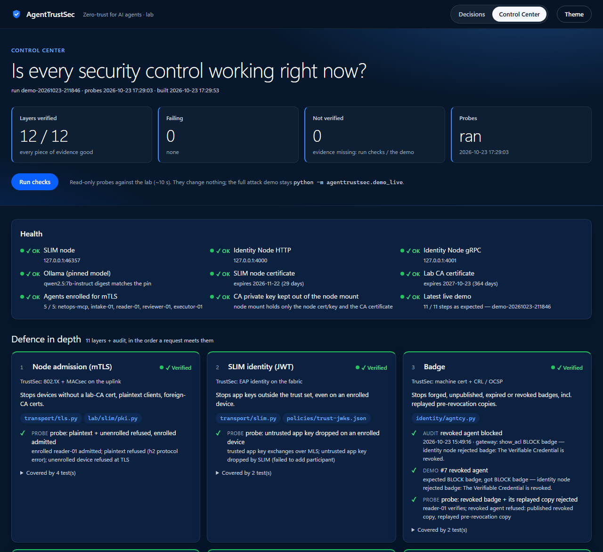
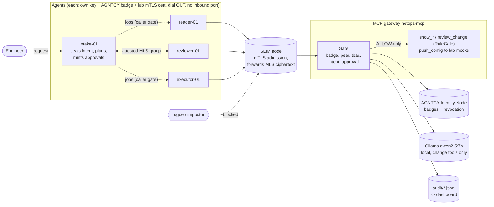
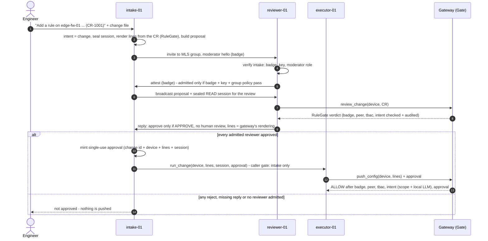
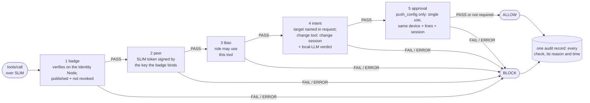
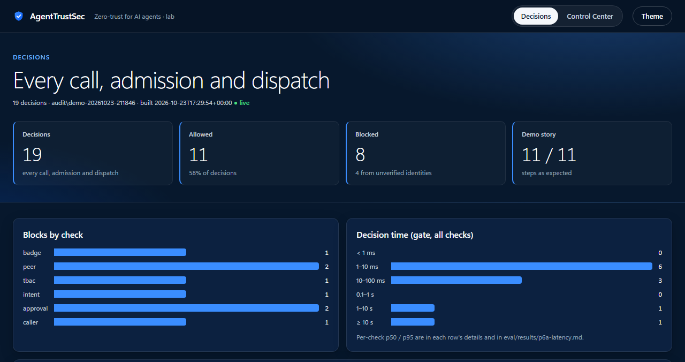

# AgentTrustSec

**Zero-trust for AI agents, modeled on Cisco TrustSec, built on the AGNTCY stack.**

[](https://github.com/natrajexplore/Agntcy_TrustSec/actions/workflows/ci.yml)


AgentTrustSec is a multi-agent network-operations system in which every agent must prove
**who it is** (an AGNTCY Agent Badge), prove it **holds the key** behind that identity, join an
**encrypted fabric** only as an **enrolled device** (SLIM over mTLS, MLS end to end), and call
only the tools its **role** allows (TBAC) **for the user's actual intent**. Anything not
explicitly allowed is blocked, and every decision is audited.

> **Lab project.** Network tools are mocks or lab devices — never production. Independent work;
> see the [disclaimer](#disclaimer).


<sub>The [Control Center](#control-center) on the live lab: 11 enforcement layers plus audit, each
verified by real audit records, the demo's expected-vs-actual result and read-only probes.</sub>

| At a glance | |
|---|---|
| Checks on every tool call | 5 — badge, peer (key possession), TBAC, intent, approval — plus node admission before any of them |
| Live attacks blocked | every one in the [attack matrix](#attack-matrix), against the real gateway process |
| Tests | 619 with the lab up · 564 in CI (live-lab tests skip; a guard makes sure only those do) |
| Cost of enforcement | ~0.1 ms gate logic · 26 ms p50 for a read end to end · 4.5 s for a new change (local LLM) |
| External services | none paid — local Ollama model, local AGNTCY Identity Node, local SLIM node |
| See it working | [Control Center](#control-center) — `http://127.0.0.1:8765/control`, 12 / 12 layers verified on the live lab |

## Contents

- [Why](#why) · [The mental model](#the-mental-model-trustsec--agntcy) · [Architecture](#architecture)
- [Defence in depth](#defence-in-depth) · [How a change flows](#how-a-change-flows) · [How a tool call is decided](#how-a-tool-call-is-decided)
- [Findings](#what-building-it-has-proven) · [Attack matrix](#attack-matrix)
- [Getting started](#getting-started) · [Configuration](#configuration) · [Live demo and dashboard](#live-demo-and-dashboard) · [Control Center](#control-center)
- [Operations runbook](#operations-runbook) · [Testing and CI](#testing-and-ci) · [Known limitations](#known-limitations)
- [Repository layout](#repository-layout) · [Documentation](#documentation) · [Roadmap](#roadmap)
- [Contributing](#contributing) · [Security](#security) · [Built on](#built-on) · [Disclaimer](#disclaimer) · [License](#license)

---

## Why

AI agents are getting real tool access: they read device configs, review firewall changes and
push configuration. That turns classic agent failures into network incidents:

* a **prompt-injected or compromised agent** tries a change during a read-only task
* a **stolen credential** is replayed by an impostor agent or a fake tool server
* an **over-privileged agent** calls tools far outside its job
* a **revoked agent** keeps working because nobody re-checks its identity
* an **eavesdropper** reads agent-to-agent traffic or slips into a review group

Network security solved the equivalent problems for users and devices long ago. Cisco
TrustSec / ISE does it with 802.1X identity, security-group tags, an SGACL matrix, posture,
MACsec, enforcement at the switch and Live Logs. **AgentTrustSec applies the same model to
agents**, using the open AGNTCY stack from Cisco Outshift.

An engineer asks for a read-only ACL audit. Behind the scenes an intake agent seals that intent,
reader and reviewer agents gather and assess data, and an executor exists for approved changes
only. If any agent goes rogue — or an attacker copies a badge, spoofs a name, replays an
approval or stands up a fake tool server — the call is **blocked before the tool runs**, and the
audit trail shows exactly which layer stopped it and why.

Design principles (non-negotiable, see [`CLAUDE.md`](CLAUDE.md)):

1. **Deny by default.** No wildcard allows, no dev bypass; an error in any check = BLOCK.
2. **Never weaken a check to pass a test.**
3. **Every decision is audited** — one record per call, every check result included.
4. **Change tools are special** — valid badge, allowed role, `change` intent, semantic pass, reviewer approval.
5. **No secrets in the repo; lab only; verify fast-moving AGNTCY APIs before use.**

## The mental model: TrustSec ↔ AGNTCY

| TrustSec / ISE | AgentTrustSec |
|---|---|
| 802.1X identity + machine cert | **Agent Badge** — W3C Verifiable Credential, JOSE-signed (AGNTCY Identity) |
| EAP-TLS proof of private key | **`peer` check** — the agent's SLIM token must be signed by the key its badge binds |
| 802.1X + MACsec on the uplink | **mTLS node admission** — only devices with a lab-CA cert (over their own key) reach the SLIM node |
| ISE as policy server | Identity Node + `authz/` policy engine |
| SGT (security group tag) | Agent role: `intake`, `reader`, `reviewer`, `executor` |
| SGACL matrix | [`policies/tbac.yaml`](policies/tbac.yaml) (role → allowed tools) |
| Posture / context | User intent (`read` vs `change`) sealed into the session at intake |
| CRL / OCSP check | Badge must be **published and not revoked** on the Identity Node |
| MACsec / encrypted fabric | **SLIM** sessions with **MLS** end-to-end encryption |
| Enforcement point (switch) | [`authz/gate.py`](src/agenttrustsec/authz/gate.py), run as MCP server middleware |
| Switch authenticating to ISE | Agent verifies the MCP gateway's badge, **key** and **signed tool inventory** (mutual auth) |
| Change-of-Authorization after posture | Single-use approval token, minted only after a unanimous reviewer group |
| Per-session dACL | Broker-minted, single-use token scoped to one tool + audience |
| ISE Live Logs | `audit/*.jsonl` + the decisions dashboard |

## Architecture



TrustSec reading: badges are the machine certs, `policies/identities.yaml` assigns the SGT
(role), `policies/tbac.yaml` is the SGACL matrix, mTLS to the node is 802.1X on the uplink,
SLIM + MLS is the MACsec fabric, the gate is the enforcement point, and the audit trail is ISE
Live Logs.

## Defence in depth

Each layer stops something the others don't. A request must pass all of them, in this order.

| # | Layer | Stops | Where |
|---|---|---|---|
| 1 | **Node admission (mTLS)** | devices without a lab-CA cert, plaintext clients, foreign-CA certs — before anything else | [`transport/tls.py`](src/agenttrustsec/transport/tls.py), [`lab/slim/pki.py`](lab/slim/pki.py) |
| 2 | **SLIM identity (JWT)** | app keys outside the trust set, even on an enrolled device | [`transport/slim.py`](src/agenttrustsec/transport/slim.py), [`policies/trust-jwks.json`](policies/trust-jwks.json) |
| 3 | **`badge`** | forged, unpublished, expired or revoked badges (incl. replayed pre-revocation copies) | [`identity/agntcy.py`](src/agenttrustsec/identity/agntcy.py) |
| 4 | **`peer`** | copied badges, spoofed names — the transport identity must hold the badge-bound key | [`authz/peer.py`](src/agenttrustsec/authz/peer.py) |
| 5 | **`tbac`** | roles calling tools outside their job; scope (target must be named in the request) | [`authz/tbac.py`](src/agenttrustsec/authz/tbac.py), [`policies/tbac.yaml`](policies/tbac.yaml) |
| 6 | **`intent`** | change tools in a read session; changes the user didn't ask for (local-LLM verdict) | [`authz/intent.py`](src/agenttrustsec/authz/intent.py), [`authz/semantic.py`](src/agenttrustsec/authz/semantic.py) |
| 7 | **`approval`** | unreviewed pushes, other lines than approved, replay (also after a gateway restart) | [`authz/broker.py`](src/agenttrustsec/authz/broker.py), [`authz/replay.py`](src/agenttrustsec/authz/replay.py) |
| 8 | **Review cross-check** | config lines that don't implement the reviewed change request | [`review/render.py`](src/agenttrustsec/review/render.py), [`agents/reviewer.py`](src/agenttrustsec/agents/reviewer.py) |
| 9 | **Server trust (agent side)** | impostor gateways, gateways serving tools their badge doesn't sign | [`mcpgate/client.py`](src/agenttrustsec/mcpgate/client.py), [`mcpgate/inventory.py`](src/agenttrustsec/mcpgate/inventory.py) |
| 10 | **Group admission** | impostors joining the reviewer group, fake moderators — before any broadcast | [`transport/slim_group.py`](src/agenttrustsec/transport/slim_group.py), [`authz/groups.py`](src/agenttrustsec/authz/groups.py) |
| 11 | **Caller gate** | worker agents giving each other jobs (confused deputy) | [`agents/jobserver.py`](src/agenttrustsec/agents/jobserver.py) |
| — | **Audit** | silent failures: one record per decision, every check, its reason and time | [`audit/log.py`](src/agenttrustsec/audit/log.py) |

## How a change flows



A change file carries only the device and the RuleGate change request. The config lines are
**rendered** from that request by RuleGate's deterministic PAN-OS / FMC renderer — never written
by hand — and each reviewer approves only if the proposed lines are exactly what the gateway's
own RuleGate rendered. The approval token then binds those lines.

## How a tool call is decided



Any error inside a check is a BLOCK, and checks after a failure are skipped (an approval is never
consumed by a call that fails earlier). The agent side mirrors the gate: a result counts only if
the gateway's badge verifies, the gateway proves it holds the key bound to that badge, and the
badge signs the tool and every argument that was called.

## What building it has proven

Everything below was tested against live lab nodes (AGNTCY Identity Node 0.0.26, SLIM 3.4.5
with `slim-bindings` 3.3.6, `mcp` 2.3). Reproducible probes and runbooks are in
[`docs/notes-p1.md`](docs/notes-p1.md), [`docs/P3-design.md`](docs/P3-design.md) and [`lab/`](lab/).

| Finding | What we did about it |
|---|---|
| AGNTCY badges carry **no role** | Role comes from our own map (`policies/identities.yaml`), never from the agent |
| The Identity Node's `Verify` checks revocation only **inside the presented badge** — a revoked agent replaying its original copy still gets `status=True` | Verifier also requires the badge to be among the node's **published, unrevoked** copies (OCSP-style) |
| AGNTCY badges are **bearer** credentials — no proof of key possession | Each agent has its own key; the issuer signs its thumbprint into the badge; the `peer` check demands a SLIM token signed by that key |
| SLIM shared-secret mode is a **group PSK**: any name is accepted with the secret | JWT identity with a per-agent key instead |
| SLIM JWT mode accepts **a trusted key claiming another name** | `peer` check binds name ↔ key itself |
| SLIM silently **ignores trust keys without `alg`** | Such keys are refused loudly at startup |
| In SLIM **group** sessions, an app registered under a reviewer's name with another trusted key is **admitted and can read** the next broadcast | Admission gate: no broadcast until every member attests (badge + key + group policy) |
| The lab SLIM node accepted **any client over plaintext** | mTLS node admission with a lab CA; client certs issued over each agent's existing key |
| The MCPServerBadge signs the tool list **as issued** — it silently went stale when a tool changed | Gateway refuses to start on drift; agents trust only signed tools; badge re-issued, stale one revoked |
| Used approvals lived **in memory** — replayable against a restarted gateway | Spent-token store in SQLite (atomic across processes, fail closed) |

## Attack matrix

Run live against the real gateway process and agents — every attack is stopped as designed.

| Attack | Stopped by |
|---|---|
| Device without a lab client cert dials the SLIM node | **node** — mTLS refused (`certificate required` / `unknown ca`) |
| Enrolled device, app key outside the trust set | SLIM identity — never reaches the gate |
| Trusted key + someone else's SLIM name + their badge | `peer` — not signed by the badge's key |
| Own key presenting another agent's badge | `peer` — not the badge holder |
| Spoofed token subject | `peer` — identity mismatch |
| Revoked agent (incl. a replayed pre-revocation copy) | `badge` — revoked |
| Genuine reader calls `push_config`, even with a change session and an approval | `tbac` |
| Genuine executor pushes config in a read-only session | `intent` |
| Executor pushes lines other than the ones the reviewers approved | `approval` — lines differ |
| Executor presents the same approval twice | `approval` — replay |
| Approval replayed against a **restarted** gateway | `approval` — already used (SQLite store) |
| Change file pairs a clean change request with hand-written lines | refused at intake; reviewer rejects lines ≠ gateway rendering |
| Any/any change request (RuleGate CR-1003) | reviewer rejects → no approval → never pushed |
| Impostor gateway with a copied server badge | agent rejects the result (no key) |
| Gateway serving tools its badge doesn't sign | gateway refuses to start; agent refuses the result |
| Impostor joins the reviewer group under a reviewer's name | admission `peer` — removed before any broadcast |
| Fake moderator (valid agent, wrong role) invites reviewers | reviewers refuse it before attesting |
| A worker agent (not intake) gives another worker a job | `caller` — confused-deputy guard |

## Getting started

### Prerequisites

| Tool | Needed for | Version used |
|---|---|---|
| Python | everything | 3.10 – 3.12 |
| [uv](https://github.com/astral-sh/uv) (or pip) | installing | any recent |
| Docker | lab Identity Node + SLIM node | Docker Desktop / Engine |
| [Ollama](https://ollama.com) | local LLM verdicts for change tools | `qwen2.5:7b-instruct` (pinned digest) |
| AGNTCY `identity` CLI | issuing / publishing badges for your own lab | 0.0.26 node |
| ~16 GB RAM | full live demo with the model loaded | peak 14.2 GB measured |

### Quick start (no infrastructure)

Unit tests and the offline scenario demo need nothing running:

```bash
uv venv && source .venv/bin/activate
uv pip install -e ".[dev]"
pytest -q                      # live-lab tests skip themselves
python -m agenttrustsec.demo   # runs scenarios/*.yaml against the gate
```

### Full lab

```bash
uv pip install -e ".[dev,agntcy,slim]"
docker compose -f lab/identity/docker-compose.yml up -d     # AGNTCY Identity Node
python lab/identity/agent_keys.py intake-01 reader-01 reviewer-01 executor-01 netops-mcp \
    --export-jwks policies/trust-jwks.json                    # per-agent keys (public JWKS only)
#   issue + publish badges (agents + gateway): docs/notes-p1.md Identity steps 1-4, 7 and 9
python lab/slim/pki.py                                        # lab CA + node cert + mTLS client certs
docker compose -f lab/slim/docker-compose.yml up -d           # SLIM node: admits enrolled devices only
ollama pull qwen2.5:7b-instruct
export AGENTTRUSTSEC_BROKER_KEY=$(python -c "import secrets;print(secrets.token_hex(32))")
export IDENTITY_NODE_GRPC_SERVER_URL=localhost:4001 IDENTITY_NODE_USE_SSL=0
python -m agenttrustsec.mcpgate.serve --transport slim --server-id <gateway metadata id>
```

Keys live in `~/.agenttrustsec/keys/`, certificates in `~/.agenttrustsec/pki/` and spent tokens
in `~/.agenttrustsec/state/` — never in the repo.

## Configuration

| Setting | Default | Purpose |
|---|---|---|
| `AGENTTRUSTSEC_BROKER_KEY` | per-process random | hex, ≥ 64 chars; shared by the gateway and intake to seal sessions and mint approvals |
| `AGENTTRUSTSEC_PKI` | `~/.agenttrustsec/pki` | lab PKI folder (CA, node cert, client certs) |
| `AGENTTRUSTSEC_PKI_NODE` | `~/.agenttrustsec/pki/node` | what the SLIM container mounts read-only (never the CA key) |
| `IDENTITY_NODE_GRPC_SERVER_URL` | — | AGNTCY Identity Node gRPC, e.g. `localhost:4001` |
| `IDENTITY_NODE_USE_SSL` | — | `0` only for the local lab node |
| `serve --slim` | `https://127.0.0.1:46357` | SLIM node endpoint (mTLS; `http://` is refused) |
| `serve --jti-db` | `~/.agenttrustsec/state/jti.sqlite3` | spent-token store; unavailable = refuse to start |
| `serve --audit` | `audit/decisions.jsonl` | gateway decision log |

## Live demo and dashboard

One command runs the whole story on the lab: it starts the gated gateway and the reader, reviewer
and executor agents (all dial OUT to SLIM), runs the legitimate flows and the rogue attacks,
prints each step against its expectation plus an ISE Live Logs view of the gateway's decisions,
and stops everything it started. Exit code 1 on any mismatch.

```bash
docker start identity-postgres && sleep 4 && docker start identity-node   # lab Identity Node
docker compose -f lab/slim/docker-compose.yml start                        # lab SLIM node (mTLS)
ollama serve                                   # if not already running
python -m agenttrustsec.demo_live              # full run
python -m agenttrustsec.demo_live --quick      # skips the two attacks that need extra LLM verdicts
```

```
== Act 1 rogue at the gateway ==
  ✔ #1 trusted key + copied reader badge        BLOCK peer       peer token not signed by the badge's key ...
  ✔ #2 genuine reader calls push_config         BLOCK tbac       role 'reader' not permitted for 'push_config'
  ✔ #3 executor pushes in a read session        BLOCK intent     'push_config' is a change tool but session intent is 'read'
  ✔ #4 approval for other lines                 BLOCK approval   lines differ from the approved change
  ✔ #5 approval used twice                      BLOCK approval   approval already used (replay)
  ✔ #7 revoked agent                            BLOCK badge      identity node rejected badge: ... revoked.
== Act 2 reviewer group ==
  ✔ #6 impostor joins under reviewer's name     BLOCK group/peer peer token not signed by the badge's key ...
== Act 3 executor up ==
  ✔ reader-01 gives the executor a job          BLOCK caller     role 'reader' may not dispatch to executor-01
== Act 4 all agents up ==
  ✔ read: intake -> reader -> show_acl          ALLOW -          job done
  ✔ change CR-1003 any/any                      BLOCK review     reviewer-01 rejected: RuleGate decision 'REJECT'
  ✔ change CR-1001 clean -> push                ALLOW -          pushed after unanimous review
RESULT: all expectations met
```

Each run writes its audit trails to `audit/demo-<time>/` (gateway, group admissions, each agent's
dispatch log). On the 15.5 GB dev laptop: **14.2 GB peak** with a cold model, ~50 s for the full
run. Acts 1–3 run before the impersonated agents start because SLIM routes by name.

### Decisions dashboard

```bash
python -m agenttrustsec.dashboard                 # latest demo run -> audit/demo-<time>/dashboard.html
python -m agenttrustsec.dashboard --serve         # live view on http://127.0.0.1:8765 (localhost only)
```



One self-contained HTML page (no CDN): totals, blocks per check, a decision-time histogram, the
demo's expected-vs-actual table, and an ISE Live Logs-style table across every audit trail —
filter by source, agent, tool, verdict or blocking check; click a row for every check with its
reason and time. `*` marks a claimed identity that was never verified. With `--serve`, a tab bar
switches between **Decisions** and the **[Control Center](#control-center)**.

## Control Center

**Is every security control working right now?** One page answers it, layer by layer, with
evidence — never with a green light by default.

```bash
python -m agenttrustsec.dashboard --serve           # http://127.0.0.1:8765/control
python -m agenttrustsec.controlcenter status        # the same view in the terminal (exit 1 if anything fails)
```

| Part | What it shows |
|---|---|
| **Layer cards** (11 + audit) | status, TrustSec analogy, what the layer stops, where it lives, the tests that pin it |
| **Evidence** | the latest live demo's real audit records (e.g. the `peer` BLOCK of a copied badge), that demo's expected-vs-actual result, and probe results |
| **Run checks** | 8 read-only probes, ~10 s: plaintext + unenrolled device refused / enrolled admitted · untrusted app key dropped · revoked badge and its replayed copy rejected · unknown tool and wrong role blocked · change tool in a read session blocked · replay refused after a restart (temp store) · tampered config lines rejected · gateway badge signs exactly the served tools |
| **Health** | SLIM node, Identity Node, Ollama (pinned digest), node + CA certificate expiry, mTLS enrolment of every agent, CA private key kept out of the node mount, latest demo result |

**Deny by default, in the UI too.** A layer is *Verified* only when every piece of its evidence is
present and good; missing evidence is *Not verified*, anything contradicting it is *Failing*.
Before any probe run, only the four layers the demo alone proves are green. Probes only observe —
they never change lab state — and run in a child process with a timeout; a probe error is a
failure, never a pass.

**The local server is hardened** so a web page in your browser can neither drive nor read it:
bound to 127.0.0.1; every request needs `Host` = `127.0.0.1` / `localhost` on that port (DNS
rebinding); **Run checks** is a POST that needs a matching `Origin` and a random per-launch token
embedded in the page (CSRF); one run at a time; no CORS; strict CSP, `X-Frame-Options: DENY`,
`nosniff`, `no-referrer`. All audit text is rendered as text, never HTML. Launching the attack demo
is deliberately not in the UI — it stays `python -m agenttrustsec.demo_live`.

**Design.** A navy, enterprise-style UI (light theme one click away, remembered per viewer), with
every text / background pair contrast-checked to WCAG AA in both themes and status always shown as
icon + label, never colour alone. It works down to phone width. The look is inspired by
cisco.com's visual language; no Cisco logo, name or proprietary font is used.

### What it costs ([`eval/results/p6a-latency.md`](eval/results/p6a-latency.md))

| Call through the live gateway | p50 end to end | of which the gate |
|---|---|---|
| read (`show_acl`) | 26 ms | ~5 ms (mostly Identity Node lookups) |
| change, new request (local LLM verdict on CPU) | 4.5 s | 4.5 s (`intent`) |
| change, repeated request (cached verdict) | 30 ms | ~6 ms |

Offline, the enforcement logic itself is ~0.1 ms per decision. Every check's time is in the audit
record (`elapsed_ms`). Reproduce with `python eval/bench.py live --write`.

## Operations runbook

| Task | How |
|---|---|
| Renew the lab mTLS certs (30-day certs) | `python lab/slim/pki.py` then `docker compose -f lab/slim/docker-compose.yml restart` |
| Remove one device from the fabric | revoke its badge (`lab/identity/revoke_badge.py`), delete its key, re-run `pki.py` |
| Rotate the lab CA | `python lab/slim/pki.py --rotate-ca`, restart the node — every old cert stops working |
| A gateway tool's name, description or arguments changed | the gateway refuses to start (drift); re-issue its badge and revoke the stale one — [`docs/notes-p1.md`](docs/notes-p1.md) §10 |
| Revoke an agent | `python lab/identity/revoke_badge.py <metadata id> [--vc-id <id>]` (dry run without `--yes`; irreversible) |
| Inspect what happened | `python -m agenttrustsec.dashboard <audit dir> --serve` (Decisions + Control Center) |
| Check every control in one go | `python -m agenttrustsec.controlcenter status` or **Run checks** at `/control` |

## Testing and CI

| Tier | What | Where it runs |
|---|---|---|
| Unit | gate, policies, broker, replay store, renderer (byte-identical to RuleGate), inventory drift, PKI, Control Center + its server hardening, ported RuleGate suite | everywhere — 564 tests |
| Live | real Identity Node, SLIM node over mTLS, real badges and keys, local LLM, end-to-end demo, every Control Center probe | your lab — 619 tests total, skip themselves otherwise |

[GitHub Actions](.github/workflows/ci.yml) runs on every pull request and every push to `main`:

* **test** on Python 3.10, 3.11 and 3.12, followed by a **skip guard** — only "lab absent" skip
  reasons are allowed, so an import failure can never hide as a skip.
* **secrets** — gitleaks over the full history; [`.gitleaks.toml`](.gitleaks.toml) allowlists only
  reviewed public values, each scoped to one rule, file and shape.
* GitHub-hosted runners only, no secrets, `contents: read`, actions pinned to commit SHAs.

`main` is branch-protected: every change lands through a pull request with all four checks green.
The release gate stays manual — the full suite with the lab and Ollama up, plus
`python -m agenttrustsec.demo_live`.

## Known limitations

Stated plainly, so nobody mistakes the lab for more than it is:

* **Mock devices only.** `push_config` records lines; nothing reaches a real firewall. FMC
  payloads keep RuleGate's `<UUID …>` placeholders.
* **Keys are unencrypted on disk** (`~/.agenttrustsec/keys`, `pki/ca.key`). Protecting them at rest
  (OS keyring / DPAPI or encrypted PKCS#8) is the top open item.
* **One reviewer** in the lab pool, so "unanimous" is a single reviewer today.
* **No certificate revocation on the SLIM node** (none found in SLIM 3.4.5): removing a device
  means revoking its badge and re-running the PKI, or rotating the CA. The node admits any lab-CA
  cert per connection; names stay bound by the SLIM token and the `peer` check.
* **Badges have no expiry** (the CLI sets none); their lifecycle depends on revocation.
* **The Identity Node's gRPC is plaintext** on 127.0.0.1 (the upstream lab compose).
* **The intent checker over-blocks:** on the ASTRA benchmark it blocks 26% of legitimate calls
  (1 in 18 on the netops set); it errs on the side of BLOCK by design.
* **Dev-grade broker:** sealed sessions and approvals are HMAC tokens; a production version would
  use AGNTCY-issued credentials or token exchange behind the same interface.

## Repository layout

```
src/agenttrustsec/
  models.py              Decision, CheckResult, ToolCall, Session, TransportPeer
  identity/badge.py      BadgeVerifier interface + LocalDevVerifier (dev only)
  identity/agntcy.py     AgntcyBadgeVerifier: node verify + published/revoked check + bound key + signed tools
  identity/keys.py       RFC 7638 key thumbprints, trust JWKs
  authz/gate.py          badge → peer → TBAC → intent → [approval] → ALLOW/BLOCK + audit
  authz/tbac.py          role → tool policy and scope (deny by default)
  authz/intent.py        intent checker: keywords for reads, local-LLM verdict for change tools
  authz/semantic.py      LlmMatcher + Ollama judge (pinned model, fail closed)
  authz/peer.py          peer check: transport identity must hold the badge-bound key
  authz/broker.py        sealed sessions; single-use scoped tokens and change approvals
  authz/replay.py        spent-token store (SQLite): single use survives a gateway restart
  authz/groups.py        group admission: badge → peer → group policy
  mcpgate/               gate as MCP middleware, agent-side client, gateway runner,
                         signed tool inventory vs served tools (drift = refuse)
  transport/slim.py      MCP over SLIM (MLS P2P); reports and pins the peer
  transport/tls.py       mTLS to the SLIM node: enrolled client cert per key, no plaintext
  transport/slim_group.py  attested MLS group sessions (reviewer pool)
  review/                RuleGate's deterministic review core + PAN-OS / FMC renderer
  agents/                runtime, caller gate (jobserver), intake, reader, reviewer, executor, rogue
  audit/log.py           JSONL audit writer
  tools/                 mock network tools and a mock external API
  demo.py  demo_live.py  offline scenario demo; end-to-end demo on the live lab
  dashboard.py           self-contained decisions dashboard (+ --serve on localhost, hardened)
  controlcenter.py       Control Center: per-layer status from evidence + read-only probes
policies/                tbac.yaml, identities.yaml, groups.yaml, trust-jwks.json (public keys)
lab/                     Identity Node + SLIM compose, PKI, key/revoke tools, agents.yaml,
                         changes/ (lab change orders), historical P1 probes
scenarios/  eval/        attack/demo scenarios; ASTRA-based intent evaluation and benchmarks
docs/                    architecture + threat model, runbooks, phase designs
tests/                   unit tests + live tests against the lab
```

## Documentation

| Document | Contents |
|---|---|
| [`docs/ARCHITECTURE.md`](docs/ARCHITECTURE.md) | goals, actors, decision pipeline, threat model |
| [`docs/notes-p1.md`](docs/notes-p1.md) | lab runbooks: Identity Node, badges, revocation, key binding, badge re-issue |
| [`docs/P3-design.md`](docs/P3-design.md) | transport: key-bound identity, SLIM, peer check, attested groups, mTLS admission |
| [`docs/P4-design.md`](docs/P4-design.md) | intent: scope check, embeddings vs local LLM, evaluation |
| [`docs/P5-design.md`](docs/P5-design.md) | agents, reviewer group, approvals, change → config, replay store, drift check |
| [`eval/results/`](eval/results/) | intent-checker evaluations (ASTRA, netops) and latency / block-rate benchmarks |

## Roadmap

| Phase | What | State |
|---|---|---|
| P0 | Gate, TBAC, audit, mock tools, tests | ✅ |
| PA | MCP gateway, mutual server badges, token broker for external data | ✅ |
| P1 | Learn by running SLIM, Identity, CASA | 🟡 SLIM + Identity done; CASA parked |
| P2 | Real AGNTCY badges: issue, verify, revoke | ✅ incl. the revocation-replay fix |
| P3 | SLIM transport with key-bound identity | ✅ keys, adapter, peer check, gateway on SLIM, attested reviewer groups |
| P4 | Intent: scope check + local LLM verifier for change tools, evaluated on ASTRA | ✅ |
| P5 | Real agents, RuleGate PAN-OS / FTD reviewer group, approval tokens, rogue agent, live demo | ✅ |
| P6 | Per-check timing + benchmarks, decisions dashboard, diagrams | ✅ |
| A | Change request → config: pushed lines rendered from the reviewed request, cross-checked | ✅ |
| B | Spent approvals / tokens persisted: no replay after a gateway restart | ✅ |
| C | Tool-inventory drift check; agents trust only signed tools; gateway badge re-issued | ✅ |
| E | mTLS node admission: only enrolled devices reach the SLIM node; TLS 1.3 hop | ✅ |
| F | CI (tests on 3.10–3.12, skip guard, gitleaks) + branch protection | ✅ |
| UI | Control Center (per-layer status from evidence, read-only probes) + navy enterprise restyle | ✅ |
| Next | Keys at rest, second reviewer, badge expiry policy, role-filtered `tools/list` | candidates |

## Contributing

1. Branch from `main`, keep each change PR-sized, and open a pull request — direct pushes to
   `main` are refused.
2. All four CI checks must pass; run `pytest -q` with the lab up before asking for a merge when
   you touch transport, identity or the gate.
3. Follow the non-negotiable rules in [`CLAUDE.md`](CLAUDE.md): deny by default, never weaken a
   check to make a test pass, one audit record per decision, no secrets in the repo, lab only, and
   verify AGNTCY APIs against their current source before using them (pinned versions in
   `pyproject.toml` and `lab/`).

## Security

* Please report vulnerabilities **privately** (GitHub's private vulnerability reporting or a direct
  message to the maintainer), not in a public issue.
* Never commit keys, certificates, vault files or `.env` — CI scans every push with gitleaks.
* This is a lab: do not point it at production devices or production identity infrastructure.

## Built on

* [AGNTCY](https://github.com/agntcy) — Identity (badges, Identity Node), SLIM (transport, MLS)
* [Outshift open source](https://github.com/orgs/outshift-open/repositories) — CASA, ASTRA, mas-lab
* [Model Context Protocol](https://modelcontextprotocol.io) Python SDK 2.x
* [Ollama](https://ollama.com) with `qwen2.5:7b-instruct` for local intent verdicts
* Docs: <https://docs.agntcy.org>

## Disclaimer

AgentTrustSec is an independent lab and research project. It is **not affiliated with, endorsed
by or supported by Cisco Systems, Inc.** or the AGNTCY project. Cisco, TrustSec, ISE, FTD, FMC,
Palo Alto Networks, PAN-OS and other names are trademarks of their respective owners and are used
only to describe interoperability and the design analogy.

## License

MIT — see [`LICENSE`](LICENSE).
